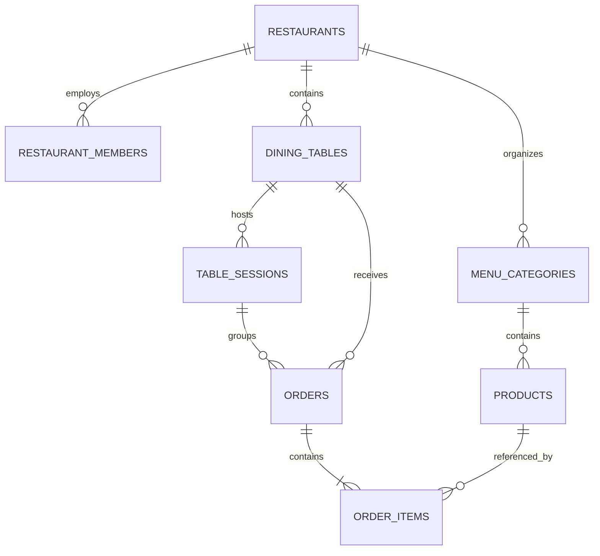

# Architecture decisions

## Permanent privacy boundary: temporary visits

Restaurant OS is a visit-based ordering platform, not a customer account platform. Customer order access is temporary and limited to the current active dining session. Historical records belong to the restaurant and are accessible only to authorized staff. Anonymous Auth is an internal security mechanism; a persistent identity or shared QR never restores a closed visit. Enforce this boundary in PostgreSQL/RLS and every customer read, including old receipt URLs, direct API requests and idempotent recovery. Preserve historical records in place.

## Permanent product boundary: no online payments

Restaurant OS is an ordering and restaurant-operations application. It never processes online payments, collects card information, authorizes/captures payments, integrates gateways or adds payment transaction/tracking infrastructure or dependencies. Restaurant employees handle payment independently outside the application. Totals are informational; customer actions are Review Order, Place Order and Order Confirmed. Every future restaurant, kitchen, waiter/bill-request and AR feature must preserve this boundary.

## One application, two experiences

Use a single Next.js App Router application, with `(customer)`, `(confirmation)`, `(history)`, `(staff)` and `(staff-auth)` route groups. Route groups share root metadata and design tokens but have independent layouts. This keeps deployment and maintenance small while letting the guest experience and operations UI evolve separately. Root `/` selects an entry URL by the explicit data mode: fixture table in demo mode, public Casa Mesa browsing in live mode.

Customer routes:

- `/r/[restaurantSlug]`: public restaurant menu.
- `/r/[restaurantSlug]?table=<opaque-token>`: QR entry, resolved on the server to one active table of the requested published restaurant.
- `/r/[restaurantSlug]/products/[productId]`: public dish details and customization.
- `/r/[restaurantSlug]/cart`: editable persistent bag, background trusted review and explicit live order submission on one screen.
- `/r/[restaurantSlug]/review`: compatibility redirect to the bag after server table-context validation; existing links/retries retain their visit context.
- `/r/[restaurantSlug]/orders/[orderId]`: private server-owned confirmation snapshot, independent of public menu publication.
- `/r/[restaurantSlug]/orders`: Current orders; private receipts and totals for the active dining visit only. Its separate `(history)` loading boundary does not stream private confirmation responses before ownership checks.
- `/r/[restaurantSlug]/bill`: current-session shared aggregates and bill requests, authorized by staff confirmation; other diners’ private orders remain inaccessible.

Staff routes: `/admin`, `/admin/orders`, `/admin/menu`, `/admin/tables` are protected in live mode by remotely verified permanent identity and current membership. `/admin/login` lives in `(staff-auth)` outside that layout. Each query/action independently authorizes the target workspace; layout guards alone do not secure mutations. A simple selector chooses among verified memberships. Its cookie is an untrusted preference, revalidated on every request; stale tabs cannot operate a changed active restaurant. Explicit demo mode uses public fixtures and disabled actions. Menu/table definition editing remains outside the current increment; table-session operations are implemented.

Server Components are the default. Category selection and active navigation use small Client Components. The menu query boundary selects demo/live via `APP_DATA_MODE`. With auto mode, complete public credentials enable live data; absent credentials enable explicit fixtures. Partial configuration and live failures throw errors. Stateless public clients ensure staff cookies never widen public menu visibility. Queries filter publication, activity, availability, and tenant IDs; request-scoped React caching deduplicates reads without caching token validity across requests. Supabase clients are instantiated on demand and never at module import/build time.

## Everyday interface

Owners/managers also have **Daily history** at `/admin/history`. A stable,
read-only, manager-authorized PostgreSQL RPC computes full-day totals and dish
rankings independently of the 40-receipt keyset page. The date follows the
restaurant IANA timezone with independent midnight boundaries for DST. Orders
belong to their placement day and retain their current status. Confirmed
accepted/preparing/ready/served amounts and unit quantities exclude pending and
cancelled orders, which have separate counts/amounts. No payment or revenue is
verified. Different historical currencies are reported separately, never added.
Ranking groups by product identity and uses original item names/prices/options,
so catalog edits and archival cannot rewrite history. Dishes with no confirmed
orders are not ranked because historical menu availability is not recorded.

The route verifies staff identity, active workspace and manager role before
fetching; the RPC rechecks caller/tenant/role itself with fixed search_path and
authenticated-only execution. It exposes no guest identifiers. A restaurant/day
index supports range reads; no history RLS is broadened and no rows are changed.
The dashboard/chart are Server Components with native GET date navigation and
disclosures, plus one small explicit refresh control. It opens no extra Realtime
subscription. Demo fixtures are clearly labelled and never replace live failures.
See [daily history rules and verification](daily-history.md).

`/admin` opens the actual kitchen queue rather than a separate overview gate;
`/admin/orders` is a compatible route to the same experience. Staff navigation has
Orders, Tables, Edit menu and Restaurant settings, filtered by verified role as
before. Three queue tabs carry status counts once: To prepare, Ready for service and
Completed. Cards offer Ready for service → Mark served, plus guarded pending
decline. New and legacy accepted/preparing tickets share To prepare.

Shared action styles use green for confirmation, blue for prepared tickets/assistance,
amber for attention/readiness, and red for decline/closure. Every action keeps a
text label, visible focus and a 48px target; colour never carries meaning alone.
Native disclosures keep previous visits, QR printing, optional 3D, earlier uploads
and privacy explanations accessible without crowding routine tasks. Reordering
is explicitly enabled in the menu or option editor. Product forms have one save
bar and no duplicate hide buttons alongside availability checkboxes.

Customer navigation is Menu, Bag, Sent orders and Table bill. The smaller welcome
section brings dishes forward. The bag contains editing, background price checks
and one explicit Place Order action; it does not navigate to a second review
screen. Intent edits debounce a fresh review by 500ms, with submission disabled
until the quote matches the current bag. Editing remains available while
background checks run, and freezes during actual submission. Pending attempts
show their immutable purchased snapshot rather than editable replacement items.
Unexpected prices/options still need explicit acceptance, shown directly in the
editable rows. Review failures stop automatic retries and offer a deliberate
recheck; unresolved creations keep the same durable key. Checks never submit. Automatic updates remain authoritative invalidations; manual refresh
is offered on errors/disconnection. No authorization, pricing, idempotency,
guest-session, tenant or database boundaries change in this UI revision.

## Persistence under storage faults and scenario verification

The cart store tracks the last observed durable value separately from unsaved
in-memory state. After a quota/write failure, reading the unchanged older value
must not revert quantities or purchase-cleanup receipts. The next successful
mutation persists both together. A genuinely changed cross-tab value remains
authoritative. Enabling previously blocked empty storage preserves the in-memory
bag. This does not promise survival of a full reload when the browser refuses
storage; submission still independently requires a durable safe retry reference.
No cart state is authority for order prices, identity or visit access.

The [scenario campaign](restaurant-stress-tests.md) combines seeded state-machine
tests with independent arithmetic oracles, the real migration SQL in isolated
PostgreSQL, and a separately guarded hosted API/actual-WebSocket verifier. PGlite
serializes transactions, so concurrent integrity claims come from separate
hosted requests rather than local Promise.all calls. Hosted provisioning uses
separately authorized administration; workflow calls use ordinary verified
staff/guest sessions. Never substitute the application media key. Fresh fixtures,
bounded concurrency, retained historical QA records and explicit browser/device
limitations keep repeat testing safe and reproducible.

## Clear customer ordering

Product additions explicitly say **Added to your bag · Not sent yet**, offer
Add more dishes / View bag and preserve menu search/category return context.
Durable-saving reassurance is conditional on successful browser storage; failed
storage instead warns to keep the page open. After server-confirmed creation,
the compact receipt says **Order sent**, explains no further confirmation is
needed and places Order more / View sent orders before item details. Cancelled,
offline/unverified or revoked visits never inherit reassuring success controls.
These presentation changes introduce no order mutation or authorization path;
server pricing, anonymous ownership, session generation, RLS, idempotency and
purchased-only cart cleanup remain authoritative.

## Per-dish special requests

Optional plain-text notes (up to 300 UTF-16 units) travel with each product intent,
not with prices or guest identity. JavaScript and PostgreSQL normalize outer
whitespace and CRLF consistently, reject invalid types/control characters and
keep differently worded requests as separate lines. Empty notes are omitted so
legacy cart keys, reviewed snapshots and durable idempotency retries stay valid.
The notes participate in line identity, review fingerprints, safe retries and
purchased-quantity cleanup. Product drafts retain them over AR return/reload
within the same visit; carts retain them over refresh and cross-tab updates.

The additive migration reuses order_items.notes and preserves all existing
pricing locks, order/session wrappers, RLS and transactional status workflow.
Reviews contain the exact request; creation independently validates it again and
stores it in the immutable item snapshot. Only the owning guest during an active
visit and authorized staff can read these requests. Shared-table bill functions
remain unchanged and redact private notes. Staff session history shows them.
Text is rendered as escaped React content, never HTML, and cannot change the
trusted price or authorize an extra. Menus keep working without any notes.

## Tenant isolation in PostgreSQL

The [Casa Mesa content workflow](demo-menu.md) adds explicit demonstration
recipes through normal verified manager RPCs. It is a guarded, create-only
development script with stable tenant-scoped IDs, not an application seed or
live-query fallback. Its photographs use the existing authenticated validation
gateway; it never uses the media key for catalog or order writes. Existing
products and historical order snapshots remain unchanged. No schema changes
or new runtime dependencies are required.

Every tenant-owned entity includes `restaurant_id`. Composite foreign keys bind products to categories, orders to tables, and items to orders/products **within the same restaurant**. Application filters alone cannot enforce this. Ordinary public reads may see published menus across restaurants; operational records always require membership or order ownership.

`restaurant_members` connects a restaurant to an Auth user and an `owner`, `manager`, or `staff` role. Bootstrap memberships through trusted administration; client membership writes are denied. Private security-definer functions perform membership checks without recursive membership RLS, use a fixed empty search path, and are outside the exposed API schema. Roles come from the membership table, never editable user metadata.

Explicit SQL grants complement RLS. Anonymous visitors can read published restaurant/menu data but have no table/order privileges. Guest identities can read their own order snapshots only during the associated active dining session. Staff can read their tenant queue and use the transactional transition RPC; direct status updates are revoked. They cannot rewrite totals, item snapshots or transfer orders. Owners/managers can manage their menu/tables and editable restaurant presentation fields. Their catalog records remain publicly visible only when publication/availability allows it.

## QR tokens identify a table, not a customer

Each table has a random, unique, rotatable UUID token. Keep those tokens private. The server calls a narrow `resolve_table` RPC that checks restaurant publication, slug, exact token, and active table state. Its invoker wrapper calls a private definer helper with a fixed empty search path. Only a label is returned; there is no token enumeration or unrestricted table read. Never expose all table tokens in a public menu query or trust a client-supplied table UUID. Invalid, duplicated, malformed, expired, rotated, and cross-restaurant tokens allow safe browsing with a rescan notice and are removed from navigation links. Each customer page receives a server-resolved context; the browser never derives the table label from query parameters. Valid tokens are retained in links and revalidated on navigation. The table query runs in PostgreSQL using public credentials; there is no privileged application client.

A QR URL is shared by everyone at that table, so it cannot grant access to other diners' orders. Invisible Supabase anonymous sign-in establishes an independent guest identity without email, phone, password, signup UI or installation. A dedicated HttpOnly, SameSite=Lax guest cookie namespace, Secure in production, leaves staff Auth untouched. Server `getUser()` verifies identity; proxy refreshes valid cookies, while protected requests independently authorize the guest. Browser cookie lifetime is 30 days; Supabase manages token refresh. Initial review may establish a missing guest. Submission, recovery and confirmation never create a replacement identity. Losing a session cannot recover previous orders from QR possession. See [Supabase anonymous sign-ins](https://supabase.com/docs/guides/auth/auth-anonymous).

## Orders and money

Use integer minor units (e.g. 1400 = EUR 14.00) for prices and totals, avoiding floating-point arithmetic. Initially supported currencies are EUR/USD/GBP, all with two decimal places. Restaurant currency is not editable by clients, preventing inconsistent existing product prices. Adding other currencies requires explicit exponent handling.

Order items retain product name, base/unit prices, quantity, selected modifier IDs/group/name/price and notes as snapshots. Their line total is generated from quantity and unit price. Orders retain currency, informational subtotal/total, restaurant/table label snapshots, guest identity, reference, initial pending status, idempotency key and canonical request fingerprint. Product foreign keys restrict deletion once referenced; archive/unpublish products. Nullable guest identity after Auth deletion preserves operational history.

A private database review stores the trusted selection/pricing snapshot, guest/restaurant ownership, canonical request fingerprint and a ten-minute expiry behind a random review UUID. The browser explicitly reviews this data and accepts detected changes. The atomic `create_guest_order` function independently validates identity, publication/ordering flag, active restaurant-bound QR, products/categories, quantities, modifier membership/availability/cardinality and current prices. It locks restaurant/table/catalog rows in a consistent order; product/group parent locks also block new modifier inserts through their foreign keys. It compares the current snapshot with the accepted private review, derives all ownership and money from trusted rows, and inserts the order/items in one transaction. Any failure rolls everything back. Direct client inserts, deletes and price/item edits remain denied. `total_minor = subtotal_minor`; no payment, tax collection or financial transaction is created.

Publication and `is_accepting_orders` are separate: published menus may remain browsable while ordering is paused. The ordering flag defaults to false for safe rollout. Managers may update the flag under existing tenant RLS. Private confirmations are in a separate route group so a guest-owned active-visit order remains accessible after unpublishing; missing/failed public menu reads are explicitly explained and do not become demo fixtures.

The main staff flow is `pending → ready → served`; legacy `accepted`/`preparing` states remain supported and can advance to ready. Only pending orders may become cancelled, with a required 2–300 character customer-visible reason; served/cancelled are terminal. `transition_order` validates a permanent authenticated employee and membership, locks the tenant/order, checks expected-current status, enforces the graph, writes lifecycle timestamps and inserts a staff-attributed private audit event atomically. Any audit/update failure rolls everything back. Direct client updates to status are revoked, and order/item money, ownership and snapshots remain immutable. Concurrent actions have one winner; stale requests conflict and refetch authoritative state.

## Auth and Realtime boundaries

Browser/server Supabase clients use the public publishable key under RLS. A server-only service key is now required exclusively by the validated media gateway; it is never used for orders or guest/staff identity authorization. Order creation uses a narrowly granted, strictly validated transactional database function. Never add unrestricted privileged client exports.

`src/proxy.ts` refreshes cookie sessions with `getClaims()` and prevents caching configured session responses. It does not authorize routes. Staff data access must verify the identity and membership in server code. Follow the current [Supabase SSR guidance](https://supabase.com/docs/guides/auth/server-side/creating-a-client); never authorize from an unverified `getSession()` object. Authenticated pages and responses must not share cached personalized data.

Orders and order items remain in `supabase_realtime`; the current UI subscribes only to INSERT/UPDATE on orders. Staff filters the verified restaurant; guest confirmations filter one owned order, while history filters the verified restaurant with RLS restricting delivery to that guest's orders. RLS still authorizes every delivered row. Each interface fetches an initial authorized server snapshot. Channel configuration waits for PostgreSQL subscription readiness before reporting a live connection, avoiding the SDK’s early WebSocket-join acknowledgement. Events invalidate data and trigger coalesced server refetches; raw events are never trusted UI contents. Reconnect/SUBSCRIBED, online/foreground events and visible-page checks (30 seconds for staff, five seconds for guests) reconcile missed updates. Older snapshots cannot regress newer states; records are deduplicated. Unmount and workspace changes clean up listeners/timers/channels. Authorization loss hides kitchen data; staff transient failures retain last confirmed state with explicit feedback. Guest private views are concealed whenever current access cannot be verified. Demo mode opens no subscriptions.

## Optional 3D/AR without slowing the menu

`ProductMedia` extends the existing photo block. It conditionally mounts the existing `DishViewer` through a client-only dynamic import after **View in 3D**. That component imports the installed `@google/model-viewer` only on mount and imperatively creates its custom element after event listeners are attached. No Three.js/React Three Fiber dependency or application renderer is introduced. Menu listings and unopened product pages fetch no GLB/USDZ or viewer runtime. A small public-API controller handles load/progress/error/slow/timeout, support checks, explicit AR launch, camera reset/zoom and listener/timer cleanup. Closing/retrying removes the element and source references; SDK model cache size zero avoids retaining unused models. The SDK's shared renderer and an already in-flight browser fetch may outlive the element; no private destroy API or promise of network cancellation is used. Explicit retries add a non-sensitive `preview_attempt` cache key to the same validated GLB URL because the SDK also caches failed loads; no credentials or context are appended.

Products reuse `model_glb_url` and `model_usdz_url`; nullable `model_poster_url` and `model_dimensions_m` add optimized loading art and measured [width,height,depth] metres. Database constraints reject incomplete/non-finite/implausible dimensions. Public product RLS and tenant/category filtering also enforce publication, availability and archival state. Mapping accepts only exact same-origin `/models/<restaurant>/<product>/<file>` or the configured Supabase HTTPS public `dish-models/<restaurant>/<product>/<file>` folder, with a strict GLB/USDZ/image extension allowlist. Credentials, query/hash parameters, traversal, encoded paths, unrelated hosts and cross-product/tenant paths are rejected. Invalid/missing GLB leaves normal photography. USDZ/poster failure never changes pricing or ordering. The manager-only upload gateway validates bytes and registry ownership; private reviews record rights/provenance and measurement notes before customer 3D is enabled. The supported public Storage paths also include the immutable `restaurant-media/restaurants/<restaurant>/products/<product>/` folders. No unrestricted upload endpoint or model proxy exists.

After a successful model load, `getDimensions()` must agree with declared measured geometry (5% or 2mm tolerance) before enabling AR. The application additionally requires HTTPS and the SDK's `canActivateAR` capability. `ar-scale=fixed`, horizontal placement, neutral environment, soft shadows and an attractive starting camera preserve original baked dimensions. No arbitrary runtime rescaling estimates a portion. Matching metadata is a consistency check, not proof of a restaurant's actual portion size; asset onboarding and physical-phone measurement remain required. Interactive 3D works without AR metadata or supported hardware. The native launcher remains synchronous with the customer's click. WebXR guidance can accompany the browser session; native Quick Look/Scene Viewer use their own placement/exit controls. The normal product page retains all customization and bag actions, without native overlays or automatic ordering. A failed launch remains a 3D view and never claims successful AR.

The first licensed sample is Microsoft's CC0 avocado, a clearly labelled development ingredient study on the explicit demo eggs product, never a real dish/portion representation or live fallback. Offline preparation bakes cut-side-up orientation, Y=0 and a declared 10cm reference length into the geometry, resizes textures to 512px and rebuilds the self-contained GLB. The 628,136-byte result has 682 triangles and measures 0.067670 × 0.043911 × 0.100000m. No production-quality food mesh is fabricated. Faithful scans, matching dish posters and physical iOS/Android certification remain onboarding requirements. Source/license, preparation script and hash/dimension reports are versioned. See [asset guide](3d-assets.md) and [official model-viewer AR documentation](https://modelviewer.dev/examples/augmentedreality/).

Product customization uses a small `useSyncExternalStore` draft in tab-local sessionStorage, scoped by restaurant, data mode, product and visit key. Catalog revision validation discards stale/invalid drafts; a new visit purges prior-generation drafts. The draft stores intent only, never Auth, prices as authority or private order snapshots. Opening/closing AR changes neither the bag nor the product state; native return/reload restores valid in-progress selections. Blocked storage retains in-memory ordering and explains the reload limitation. Existing server add/review/order validation and table-generation revocation remain independent and authoritative.

`ProductMedia` presents the viewer in a native modal dialog: full-screen on small
phones, bounded on larger screens, with browser focus containment, Escape/Back
return and background scroll restored on closure. The viewer unmounts on close;
product customization and bag state remain outside the dialog. Sample/portion
disclaimers remain visible inside demonstration previews.

Camera controls have labels, keyboard controls and 44px targets. Preview panning
and tap-to-retarget are disabled so touch gestures cannot lose the dish's orbit
centre. Rotation and zoom remain available. Centre dish restores the bounding-box
target, initial orbit and field of view; AR launch synchronously resets this view
without changing geometry. A bounded, permission-free immersive-AR capability
probe runs only when the preview opens. A supported browser uses WebXR, allowing
placement/tracking feedback inside the camera. Otherwise native Scene Viewer/
Quick Look remains available. An explicit recovery control switches engines by
disposing and recreating the viewer; it never launches another camera without a
new customer click. A denied/stalled capability probe cannot block 3D browsing.
Only a real WebXR session-start/placement event shows the browser table guide;
tracking-loss/recovery events update its instructions, and an accessible Back
button uses the SDK's exit slot. Native camera viewers retain their own controls.
After 15 seconds without placement the guide explains surface-detection recovery;
it never reports a placed dish based on elapsed time. Tracking capability is not
proof of working device firmware. The documented Xiaomi 14T report requires a
real-device retest, including updated AR services, rather than geometry inflation.
The model stays anchored in world space, not attached to the screen; camera
centering cannot correct tracking drift or an incorrect physical mesh size.

No auto-rotation or animated interaction prompt is used, reduced motion removes camera interpolation, and screen-reader text explains rotation/zoom. Progress/failure/retry and unsupported-device guidance are explicit. HTTP localhost supports 3D only by product policy; phone AR certification needs a normal HTTPS deployment, not a secret-exposing development tunnel.

## Performance, accessibility, and delivery

Local photography uses Next.js image optimization, responsive `sizes`, known aspect ratios, and priority for product-detail photography. Menu thumbnails declare 80px phone/96px larger-screen slots. System sans-serif and Georgia avoid network font requests and reduce build dependencies. Shared CSS tokens establish cream, forest green, and neutral borders. Layouts adapt from narrow screens; navigation targets are at least 44px high, focus is visible, and a skip link targets the main content. A labelled row of category filter buttons and search field announce filtered dish counts. Motion respects reduced-motion preferences.

The phone menu opens on all dishes grouped in configured category/product order;
the virtual Favorites shortcut never duplicates dishes in the full list. Empty
categories are omitted. Sticky search and touch-friendly category buttons show icons, counts and an
explicit pressed state. The category strip scrolls independently of the page,
keeps the selected category in view on restore and supports keyboard focus. Search matches names, descriptions, ingredients and tags,
with case/accent normalization and no fuzzy-search dependency. It uses only the
current restaurant's already-authorized public catalog; no new database reads or
global product index are introduced. The menu has no large hero or separate 3D
promotion; model availability remains visible on the appropriate dish row.

Public `category`/`q` URL parameters preserve browsing through product navigation,
Back to menu and refresh. Server parsing bounds search length and resets unknown,
repeated or removed categories. Native replaceState avoids a network request per
keystroke or a history entry per typed character. Blocked/throttled history cannot
block browsing; product return links independently preserve the selection. All
paths are constructed within the current restaurant with the server-validated
table token. The URL is never authorization, order history or a stored purchase
intent. Existing product/cart/session security remains authoritative.
Product return links additionally target the public dish row by fragment; native
anchor scrolling and responsive scroll margins return to that dish below the
sticky controls, with a subtle row highlight and no scroll-position storage.

Menu usability validation (20 October 2026) passed 327 automated tests, including
177 PostgreSQL checks and eight new menu search/grouping/navigation regressions,
plus TypeScript, ESLint, secret scanning and a production build. A read-only
production-server check against development Supabase verified six scenarios:
unique grouped dishes, search, product return/refresh, category filtering, empty
results and removed-category recovery. Browser interaction verified search and
its product URL; the complete four-dish menu was inspected at 412 × 924 desktop
emulation. Physical-phone and smaller-viewport interaction checks remain
unverified.

No monorepo, separate API service, ORM, analytics pipeline or third-party state library is needed. Payment providers are permanently excluded. React context plus `useSyncExternalStore` manages the browser-local cart. Build with Vercel's native Next.js support; keep migrations as a separate reviewed database deployment step. Customer routes are dynamic, with no-store Supabase reads. Production builds do not query the live database. Demo mode can run without Supabase credentials, Docker, or dish models. Database types can be regenerated offline from the versioned SQL migrations using existing PGlite tooling. Database tests use actual PostgreSQL semantics via PGlite; hosted anonymous Auth/order RPCs are verified by the explicit development integration script; Realtime delivery must be verified separately against hosted Supabase; embedded PostgreSQL cannot emulate WebSocket delivery. Actual hosted API and production-browser tests verified staff/guest event delivery, tenant/ownership isolation, concurrent transitions, offline recovery, cancellation reasons and refresh persistence.

## Product customization and shopping intents

`product_modifier_groups` belongs to one product through `(restaurant_id, product_id)`. `modifier_options` belongs to one group through `(restaurant_id, group_id)`. Per-product groups keep this increment small; reusable templates can later copy or link definitions if a real requirement emerges. Required means minimum selections greater than zero. Single-choice permits at most one selection; multi-choice supports bounded minima/maxima. Options add nonnegative minor units per product unit; ingredient removals are zero-price options. Groups/options have availability, sort order, update timestamps and owner/manager CRUD policies. Public reads follow product publication/availability and active category/group visibility. There are no new definer functions or privileged keys.

The menu query boundary also loads public modifier definitions, failing explicitly if either query fails. The server renders product details from the same restaurant-scoped catalog. A fresh read-only Server Action validates additions against the current catalog, checks quantities/selections and compares the displayed revision; changed definitions require review. It writes no order, and is not a checkout authorization or pricing API. The implemented order transaction independently derives prices and revalidates availability and modifier membership.

The cart stores only purchase intents: product ID, sorted unique option IDs and quantity. Canonical selection keys merge identical choices and distinguish customizations. All totals are integer minor units, including supplements multiplied by quantity. Limits are 99 per line and 100 distinct lines. A small provider scopes a `useSyncExternalStore` store to restaurant ID and data mode; localStorage uses a versioned key and validates restaurant/mode/currency on hydration. React's server snapshot is a stable empty bag, avoiding hydration mismatches; the bag page shows a restoration state. Storage events update other tabs. Blocked storage produces an explicit notice and preserves current in-memory selections; it cannot promise persistence after navigation. No QR token, label, authentication state or client-supplied price is stored in the bag.

Each server-rendered customer shell supplies the current catalog and validated table context. Cart hydration re-derives names, options and prices from this catalog. Missing products or invalid/changed required selections remain visible as invalid lines, excluded from totals, with removal/reselection actions. The total reflects current prices on navigation/refresh; browsing is not a subscription to menu updates. Table tokens remain URL context, independent of bag identity. Demo and live bags are distinct even if a slug matches. Live mode permits secure review/submission and private confirmations; demo submission is visibly disabled. Payment processing is permanently excluded.

UI controls use native radio/checkbox groups with legends, optional single-choice clearing, 44px quantity/removal targets, visible focus, live addition/removal messages and reduced-motion support. Phone menus use compact photographed rows and sticky category controls; desktop retains the card grid. Product pages combine quantity and Add to bag in one mobile action row, with responsive photography and a desktop two-column layout. A shared safe-area navigation height positions bag, product and review actions without overlapping the four tabs. The bag keeps its total and Place Order action in reach while scrolling. Ingredients/allergens are disclosed only where supplied; missing allergens never imply safety, and modifiers may introduce additional allergens.

## Idempotency, retries and abuse bounds

The client submits only strict purchase intents, restaurant slug, original QR, observed visit generation, accepted review ID and a random idempotency key. Unknown fields, including financial/ownership/status fields, are rejected. A unique `(customer_id, restaurant_id, idempotency_key)` constraint and guest advisory transaction lock serialize competing attempts. Canonical line/option ordering yields a stable request fingerprint. Replay checks run before current review expiry/QR/catalog validation: an already committed identical request returns its immutable original order only while its visit remains active; closed/legacy replays fail without exposing a receipt or creating another order. Different contents/context with the same key are rejected. `get_guest_order` independently verifies anonymous ownership and active participation when retrieving by ID/key; table context has no authority over this read.

The browser durably stores the original pending request before network submission and coordinates tabs with Web Locks. No successful state is fabricated from local metadata. An uncertain response preserves the key/selection; recovery checks the original outcome before retrying. A lost identity blocks uncertain retry rather than creating an order under another guest. Once the server confirms success, cleanup subtracts purchased quantities from the latest scoped bag and persists a cleanup receipt with the remaining items in one write. Later additions and other restaurants' bags survive. Refreshing confirmation performs only a protected read and idempotent local cleanup.

Database limits are 20 successful reviews/minute/guest, 5 new orders/5 minutes/guest across tenants and 40/table/5 minutes across guests, serialized by guest/table advisory locks. Replays do not consume another order slot. Payloads are limited to 64 KiB, 50 customized lines, 50 selected options/line, quantities 1–99 and 500 total units. Monetary overflow is checked against existing integer column bounds before inserts. Explicit same-origin validation complements Next's Server Action CSRF/body checks and cookie policy. Customer errors use bounded messages; logs contain operation names and sanitized database codes, never raw payloads, Auth tokens or QR lists.

Definer RPCs have empty search paths, explicit authenticated-only execution grants and anonymous-caller validation. Internal helpers/private reviews have no public execution/read/write grants. Staff membership helpers explicitly reject anonymous claims, even if an administrator accidentally assigns that identity a membership. Supabase Studio's optional RLS event-trigger helper retains trusted owner execution while unnecessary public RPC grants are revoked. Public catalogue visibility and staff/guest row isolation remain enforced through existing RLS and composite tenant relationships.

Hosted Auth signup limits additionally apply to server-side anonymous signup's egress IP. Tune signup capacity and bot controls for commercial traffic without introducing broad app privileges. No privileged IP-forwarding/service-role key is used. Future operations need explicit expired-review/anonymous-user retention policies; this increment deletes no existing data and schedules no destructive cleanup. HTTPS, local storage and Web Locks are required for safe production submission. Browser emulation verifies mobile layouts; physical-device certification remains separate.

## Staff identity, Realtime transport and kitchen snapshots

Staff email/password Auth uses the existing Supabase SSR architecture with a dedicated HttpOnly, SameSite=Lax, production-Secure namespace separate from guests. Server `getUser()` verifies the employee, and restaurant membership supplies roles. Trusted administration provisions accounts and memberships; clients cannot self-assign roles. Staff sign-out clears only staff cookies. Owners/managers/staff share operational transition privileges in this increment.

A verified server action returns only the caller's short-lived access JWT for Realtime transport after checking the requested membership/guest ownership. It stays in memory and is periodically renewed through the SDK accessToken callback. No refresh token or privileged credential enters browser code. A separate stateless browser SDK disables Auth persistence, URL detection and refresh ownership, so guest/staff sessions cannot overwrite one another. Issuing the transport JWT adds no database privileges: RLS and RPC validation remain authoritative.

`get_kitchen_snapshot` validates staff access, returns the oldest 300 active and latest 100 completed orders for today's restaurant-local calendar day, plus exact metrics. Truncation is shown explicitly. Pending/accepted/preparing share To prepare; ready is a staff-only holding state; served/cancelled are completed. Time and DST boundaries use the restaurant IANA timezone. Totals are informational, never payment or revenue verification. `get_guest_order_progress` verifies anonymous ownership and returns only that order's current status/reason. Guests cannot transition orders.

`private.order_status_events` stores tenant/order, verified actor, old/new state, reason and timestamp. It has RLS with no direct caller grants and is written only by the transactional workflow. Future authorized audit views can expose selected fields; there is no audit dashboard yet. The enum and existing composite relationships are preserved. Cancellation after acceptance, employee invitations, menu/table definition CRUD, sound/push and advanced analytics remain deferred. All payment processing remains permanently excluded.

Order `updated_at` uses a dedicated clock-time trigger rather than transaction-start `now()`, advancing monotonically even when a request waits for a competing staff lock. Lifecycle timestamps are assigned after row-lock validation. Snapshot reconciliation uses these versions to avoid regressing already-confirmed progress.

## Kitchen confirmation and table service

`20261018211749_simplified_kitchen_service.sql` extends the existing transactional
`transition_order` function, without changing its signature, enum or RLS. A new
ticket can move pending → ready in one staff action; legacy accepted tickets can
also move straight to ready. Existing accepted/preparing paths remain compatible.
Staff identity, membership, tenant-scoped row locks, expected-current status,
reason validation and immutable financial/ownership information remain enforced.
The audit records one actual direct transition. Implicit staff confirmation sets
accepted_at, but preparing_at stays NULL unless a preparation-start action really
occurred. Ready → served is always a separate staff action; served/cancelled remain
terminal. Prepared food may wait for the rest of a table without any automatic
serving transition or customer readiness notification.

The migration is applied to the development project. An isolated hosted run
passed 35 API/actual WebSocket checks with two anonymous guests and concurrent
staff Ready actions. SQL inspection confirmed one pending → ready audit event
per order, separate ready → served events, unchanged amounts and NULL
preparing_at. Shared-bill approval, acknowledgement, reconnect reconciliation,
closed-visit revocation and preserved staff history were exercised. The QA
tenants are unpublished, their table inactive and both visits closed; all records
remain stored. This does not certify browser rendering or physical devices.

The session trigger authorizes the ordering guest when staff first confirm the
ticket, including marking it ready. This preserves the shared-bill security gate;
no acceptance button, automatic acceptance or QR-based membership is introduced.
New guests can always inspect their own active-visit receipt; shared-bill access
waits for the first staff confirmation. Price/state totals remain PostgreSQL-owned.

Customer receipts map pending/accepted/preparing/ready to Order sent, while actual
served/cancelled states remain visible. They omit progress bars, order clocks,
countdowns and internal cooking labels. Live reconciliation still enforces visit
revocation and updates service/cancellation; hiding presentation never replaces
database authorization. Both personal receipts and the shared bill follow this
presentation rule. Staff timestamps and historical audit records remain intact.

## Temporary customer order access

`get_guest_visit_order_history(restaurant_slug, table_token?, before_order_id?)` returns only the verified guest’s own receipts in their active visit at the selected table. Its identity check requires matching JWT subject, anonymous Auth and session participation. Pagination uses an owned current-visit cursor and stable `(created_at,id)` ordering; trusted integer totals cover all of that guest’s orders in this exact active session, not only the visible page. Pending and accepted values remain separate and cancelled orders are excluded. The former `get_guest_order_history` endpoint is now a compatibility alias for this current-visit query; it cannot retrieve an archive. Legacy NULL-session orders are staff-only.

`private.can_read_guest_order` enforces anonymous caller ownership, participation and an active restaurant-bound session in direct order RLS. Item RLS follows authorized parent orders. The public receipt and tracking RPCs apply the same check, independently of QR possession, menu publication and browser cookie lifetime. Closed visits return no receipt by ID or idempotency key, no tracking, no bill and no customer-readable session/request rows. Staff RLS and historical session RPCs remain authorized by restaurant membership. No historical data is deleted or reassigned.

The internal creator alone can build a provisional receipt before session attachment through `private.get_guest_order`; API roles cannot execute it. The public transactional creator attaches the order/participant before returning the newly authorized receipt. Persistent idempotency uniqueness remains unchanged: active replays return the original order, closed/unassigned replays raise `VISIT_ENDED` without creating another order or revealing its snapshot. An expired uncertain request must be resolved with staff, never converted into a fresh automatic submission.

The Current orders page has its own loading boundary; old confirmation URLs are authorized before streaming and return HTTP 404 after closure. Customer responses use private/no-store/max-age=0/must-revalidate headers; Supabase reads bypass shared caches. A private client view starts concealed and performs an authorized recheck before showing even a cached App Router payload. It conceals details on offline, background and pagehide, including synchronous DOM concealment for back/forward cache, and verifies again on pageshow/foreground/reconnection. Active Realtime events still invalidate authoritative snapshots. Guest access is rechecked every five seconds, with a ten-second freshness limit while a request is delayed; staff retain the thirty-second reconciliation safety poll. Closed session rows are not exposed just to deliver closure events. The database revokes access immediately at closure; an already downloaded response or a diner’s own screenshot cannot be retroactively erased.

There is no All visits tab, customer archive, profile or consumption-history feature. Current orders remains private to its guest; Table bill shares only approved active participants’ current dish snapshots and totals. All historical inspection belongs in the authenticated staff workspace.

## Dining sessions and participation

`table_sessions` binds restaurant/table, table-label/currency snapshots, active/closed state and lifecycle timestamps. A partial unique index enforces one active visit per table. Nullable `orders.session_id` has a composite `(restaurant_id, table_id, session_id)` foreign key; attached orders cannot move, and a trigger rejects attachment to closed sessions. All pre-migration orders remain unassigned, with no guest recovery after closure. No heuristic backfill occurs.

Public order/review functions wrap the existing private validators. They lock guest identity then the table lifecycle before catalog locks. Order creation, active-session creation/reuse, association and pending participation commit together. Unique constraints and table advisory locks protect concurrent first orders and staff opens. A committed replay keeps its original association and uniqueness; it returns a receipt only while that visit remains active. Private reviews capture active-session and last-closed-session identities; a stale uncommitted review cannot silently create an order in the next visit. No browser-supplied session or ownership field controls order creation.

`private.session_participants` starts pending on a valid order. Staff confirmation of that guest's first order atomically authorizes shared access, including the normal pending → ready action; legacy acceptance remains compatible. Cancelled/pending first orders do not authorize it. The normal kitchen action is the minimal participation approval; there is no extra invitation UI. Anonymous identity, matching JWT subject and current membership are independently checked in PostgreSQL, after server `getUser()` verification. The QR only selects table context. Losing a session cannot recover membership through the QR.

Approved active participants receive current-session metadata, aggregate counts/values, request acknowledgement and a narrowly scoped itemized dish list. The list groups identical stored product/customization/unit-price/status snapshots across guests, adds quantities and line amounts, and exposes only names, options, quantities, prices and order state. Customer presentation collapses internal preparing/ready states into confirmation, without a serving-time promise. Different customizations, prices or states remain separate lines. Guest identities, private receipt IDs/references, notes and previous visits are excluded. A private SQL helper performs grouping; API roles cannot execute it directly. Guests can read session/request signals only while approved and active. Closed visits return no customer session or bill metadata; short authorized rechecks detect closure without retaining historical signal access. Membership never transfers to the next visit. Private order/item RLS additionally requires an active own visit. Staff receive itemized session snapshots only after tenant membership checks.

`manage_table_session` locks the exact table/session transactionally. Open is idempotent; close requires all session orders served/cancelled and any bill request acknowledged. Concurrent stale close calls cannot close a newer visit. Closure, request resolution and private actor audit are atomic and replay-safe. Service closure does not verify payment. Public session/request rows contain no actor identities; attribution lives in private RLS-protected events.

## Shared order values and bill assistance

`session_totals` sums stored PostgreSQL order amounts for one exact session. Accepted/preparing/ready/served are confirmed; pending is separate; cancelled is excluded from total recorded order value. Integer safe-range and currency checks prevent invalid aggregation. Sessions snapshot currency, so later trusted restaurant configuration cannot relabel historical values. Aggregates cover all records even when staff browse pages of 20. These values are informational; staff confirm the final bill and handle payment independently.

`bill_requests.session_id` is unique, giving one durable request lifecycle per visit: requested → acknowledged → closed. Repeated/concurrent guest calls return the original request, including after uncertain network responses. A durable private audit limits a guest to three new requests in ten minutes across sessions; replays bypass the new-request limit. Request/acknowledgement/closure each validate active session, participation or staff membership and commit with their audit. Acknowledgement never records payment or freezes order pricing; later orders still update the recorded total.

`get_table_workspace` and `get_staff_session_orders` are stable read RPCs, with a separate non-locking membership guard compatible with PostgREST read-only transactions. Mutation guards retain membership row locks. Read authorization and data use one snapshot; every mutation independently revalidates membership. Both helper families have fixed empty search paths and narrow execution permissions.

## Session Realtime and interface boundaries

### Scoped in-app notification surfaces

`src/features/notifications` derives minimal actionable notices from authorized
snapshots. The shared staff table provider already receives orders/session/bill
invalidations across all admin routes; its active session counts and pending
requests drive the staff inbox without another subscription or privileged key.
Order-count generations deduplicate arrivals, and resolved requests/fulfilled
table actions disappear on reconciliation. The kitchen's per-ticket highlights
remain intact. Alerts link to the queue or the bill-request response section.

Customer shells boot a minimal signal action after hydration, without delaying
menu SSR or signing in new guests. `guestActivityAction` enforces live mode,
same-origin requests, bounded identifiers and remotely verified anonymous Auth.
It resolves any supplied QR/visit generation and uses the existing participant
RPC to establish an active tenant-bound visit. It then reads only the verified
guest's order IDs/status/timestamps through unchanged RLS, explicitly filtered
by restaurant, customer and session, paging all signals. Shared bill details
stay on the server; only an authorized request's delivery/acknowledgement signal
is returned. A one-way guest/visit digest scopes in-memory read markers without
exposing guest identities. QR possession never establishes participation.

Only guests with an active visit download and mount the lazy notification
Realtime transport; ordinary menu browsing loads no additional Supabase SDK
for this feature. A stable provider wraps the ordering UI, while the transport
is a separate sibling that publishes verified signals without remounting forms.
The existing screen-specific order/bill transport remains independent.
The existing guest-table scope and five-second authorized reconciliation handle
service/cancellation/request changes and closure. No internal cooking/ready
event becomes a customer notice. Before showing private alerts, the client
independently rechecks even a cached page payload. Offline/background/pagehide
concealment also covers modal/toast DOM; access loss clears the inbox. Identity,
visit or restaurant changes replace the notification store without remounting
product forms or carts. Opening/closing the native dialog restores focus to its
bell, and keyboard/touch operation is independent of 3D capabilities.

The inbox retains at most 30 current notices. Bounded tab-memory markers
deduplicate repeated snapshots and preserve read state across navigation; no
private notification payload, JWT or QR is persisted. Initial/reloaded snapshots
populate the inbox silently; subsequent meaningful arrivals display one short
banner. Reconnection restores authoritative state, not a guaranteed event log.
There is no notification database, OS push, background delivery or audio.
Existing order/session/request records remain the durable source of truth.
Demo mode displays labelled staff samples and creates no Auth/Realtime traffic.
The feature requires no SQL, RLS, Auth-cookie or environment changes.
Receipt/current-order/table-bill routes explicitly opt into a visit-only shell,
after their existing server-side authorization reads. Restaurant closing keeps
that shell, its private verification guards and notifications reachable, while
public menu/product/cart entry retains the branded closed landing screen. The
flag is presentation-only and cannot authorize records or enable ordering.

A shared staff operations provider fetches the authorized initial workspace once and subscribes to orders, table_sessions and bill_requests. It supplies the global bill-request inbox and Tables UI without appending raw event payloads. Table requests remain visible until acknowledgement, keyed by database ID. Detailed staff lists refetch every loaded order page on invalidation. Current guest bills subscribe to the same minimal signal tables plus their own order events under active-visit RLS; waiting guests discover acceptance through their owned order. Snapshots, coalescing, version checks and foreground/online recovery remain authoritative; guests also revalidate access every five seconds and hide unverified private data. Demo mode creates no subscriptions or successful mutations.

The customer has four mobile tabs: Menu, Bag, Orders, Table bill. The current bill displays every ordered dish with quantities, customization supplements, unit and line prices, cancellation exclusions and accepted/pending totals. Existing minimal session signals invalidate this itemized snapshot when another guest orders; other guests’ private order events remain RLS-blocked. The UI clearly states staff confirm the final bill. Current orders contains only this active visit. No customer archive is available. A dining session ends when staff close it, not automatically at midnight. Staff Tables provides current visits, requests, itemized snapshots, guarded closure and paginated prior sessions. Empty/loading/failure/expired-access states remain explicit. Closure rotates the table visit key. Stale bag/review contexts are discarded and require an intentional fresh selection.

The MVP does not prove physical presence: staff must accept the correct table order, close visits promptly and handle further assistance directly. Approved membership lasts until service closure; QR rotation alone does not revoke it. There is no manual participant revocation, automatic expiry, separate waiter-call type or repeated bill-request cycle within a visit. Existing legacy records are preserved without guessed associations. Shared authorization never expands private order RLS. All online payment processing remains permanently excluded.

## Cart and review visit generation

`dining_tables.visit_key` is an opaque UUID, rotated transactionally by the session-closure trigger. `resolve_table_visit` reveals only one valid published QR’s label and current generation, without session history, identities or order authority. The QR and generation are context identifiers, never authentication. Live bags and submission storage use v2 keys scoped by restaurant/mode/current generation. Previous-generation and legacy local entries are purged, but authorization never depends on this cleanup. A five-second table-context check refreshes stale open pages and clears their selections on closure; navigation/refresh resolves the key anew.

`review_visit_order` requires the observed generation, takes the existing guest/table lifecycle locks, validates trusted catalog prices and stores the generation with its private review. The old unbound review RPC is no longer executable by API roles. The final creation transaction independently checks generation, active-session and last-closed-session binding. An old cart cannot obtain a current quote with a stale key, and an old review cannot create an order in another visit. Staff historical records and review/audit rows remain preserved.

## Manager catalog and validated media gateway

Only verified non-anonymous owners/managers enter `/admin/menu` and `/admin/settings`. Every action re-verifies Auth, membership and the active restaurant cookie; mutations validate same-origin requests and bounded payloads. PostgreSQL rechecks manager membership. Direct catalog/restaurant DML is revoked from API roles; fixed-search-path SECURITY DEFINER RPCs perform scoped, optimistic, atomic category/product/modifier/settings updates and server-directed reorder operations. A per-restaurant advisory lock serializes catalog edits. Version checks reject stale editor tabs. Products have separate publication, availability and archival states; public RLS and the trusted order-snapshot function enforce all three. Product/group/choice IDs remain stable, removed choices become unavailable, and historical order/item/customization snapshots are untouched.

`menu_media_assets` is an owner/manager-readable registry, with no direct client writes. Unverified source/measurement drafts persist without enabling customer 3D. Private model reviews hold license/provenance/measurement notes and reviewer/time, outside public product rows. Product/branding asset IDs have tenant composite FKs; catalog RPCs additionally require the correct product, kind and ready state. Public 3D presentation requires model review; AR additionally requires opt-in and the existing runtime physical-bounds/capability/HTTPS checks. Human review is an attestation, not automatic certification of scanned portions or rights.

The server-only media gateway uses the service key solely for Storage and trusted registry registration. Byte/MIME/extension/size checks, full image decoding and re-encoding, actual GLB vertex bounds and self-contained USDZ package checks happen before publication. Immutable tenant/product/UUID paths avoid filename injection and stale replacements. A pending registry record precedes upload; the same upload UUID/hash can safely recover an uncertain response. Ready state follows a confirmed upload. Forty new uploads/hour/actor are permitted. Only the trusted service function can attest validation; owners cannot bypass it through direct Storage calls. Restrictive Storage INSERT/UPDATE/DELETE policies protect this bucket even if another permissive policy exists. Public read does not grant write access. `storage:setup` configures the bucket through supported APIs, never metadata DML.

Deleting an unused file first locks and marks its registry row deleting, after checking every catalog/branding reference under the same catalog lock used by saves. Such a row cannot be attached concurrently. Storage removal follows; retry finishes interrupted removal. Tombstones retain the registry identity; files are never overwritten. Replaced files remain until explicit cleanup. Public bucket contents must contain only public product/branding material, including pending/draft uploads. This MVP imposes a 4 MB request cap for Vercel compatibility; large/resumable/quarantine storage onboarding is outside scope.

All order/session/idempotency and active-visit privacy boundaries remain unchanged. No catalog operation edits orders. No payment infrastructure is introduced.

## Pilot hardening boundaries

Manual service opening reuses `is_accepting_orders` as the single authoritative
OPEN/CLOSED state. Closed service blocks trusted order pricing and new table
session insertion, including staff-started visits, under restaurant row locks.
It does not close active visits or restrict their authorized tracking/bill/kitchen
work. Public hours are informational text with an existing IANA timezone, not an
automatic scheduler. See [opening control and QR cards](opening-and-qr.md).

Table tokens can only be listed through a manager-authorized RPC. Ordinary staff
retain table labels/availability without direct token SELECT permission. Downloads
verify manager identity and active restaurant on every request, require a stable
public HTTPS origin, return private/no-store PNG/ZIP/PDF and keep token payloads
out of staff page props. Rotation locks the table/session, rejects occupied tables
and stale versions, and generates a fresh PostgreSQL token without changing orders.

Vercel builds require an explicit live/demo decision, a public HTTPS app origin,
and live configuration matching the expected Supabase project. Local auto mode is
retained. This guard reduces accidental environment mixing; it does not prove
hosted Auth, Storage or migration configuration. Deployment preflight remains an
operator responsibility. No build automatically changes hosted resources.

Baseline response headers deny framing and MIME sniffing, restrict cross-origin
referrer disclosure, constrain base/object sources and permit only same-origin
camera/WebXR. HSTS applies to configured HTTPS origins without includeSubDomains.
This is not a full nonce-based script CSP. HTTPS and physical phone support remain
independent AR requirements.

Next 16.4 recovery uses retry() to refetch server data; reset() alone can replay an
already failed render. Customer recovery keeps the restaurant/table URL instead
of sending another tenant to the default restaurant. A parent boundary catches
restaurant-layout failures and a standalone global error document covers root
layout failures. Proxy Auth refresh is maintenance, never authorization: transient
refresh exceptions reach normal route recovery, while private requests still
verify Auth/membership/ownership. Explicit demo bypasses all proxy Auth refreshes.

Media storage requests have 15-second deadlines and the browser upload has a
50-second deadline. Uncertain responses retain the original upload UUID/hash for
safe retry; timeouts are never success. Existing order submission/idempotency and
visit revocation rules remain authoritative. Public menu queries stay uncached
across requests; private snapshots retain their short access-revalidation cycle.

See [pilot audit](pilot-readiness.md), [staging](deployment.md) and
[restaurant onboarding](restaurant-onboarding.md). Hosted QA creates a separate
tenant, never reuses occupied tables and retains historical records. Browser,
physical-phone and restaurant-network validation are explicit release gates;
API/WebSocket success does not certify them. Online payments remain excluded.

Local third-party model preparation uses ignored `.local-assets`, outside the
public catalogue and deployment assets. `npm run preview:model` serves one
validated model through a loopback-only development tool, with no database/Auth
credentials or uploads and no AR. It does not authorize publication or human
physical-scale review. Approved assets still enter the existing manager media
gateway and transactional review workflow. See [Yakitori preparation](assets/yakitori.md).

An explicitly labelled product demonstration is separate from real-dish review.
Migration `20261016204244_model_demonstrations.sql` adds default-off
`products.model_demo_enabled` and the manager-only `set_model_demonstration` RPC.
The transaction verifies identity, tenant membership, editor version, a ready
tenant/product GLB, measured geometry and privately recorded source/licence plus
explicit rights confirmation. Database constraints require `model_verified=false`
and `model_ar_enabled=false` for a demonstration. The invalidation trigger clears
approval on asset/dimension changes, removed rights/source or ordinary physical
review. Public data contains only the presentation flag, never private review
notes. The catalogue mapper and viewer independently disable demo AR; both the
entry and product presentation identify it as a sample with no verified portion.
The runtime/model still load only after an explicit preview click. This opt-in
never changes demo/live environment boundaries or authorizes an unrelated asset.
